<div align="center">


# Plucky

**Turn any text into a dated task — privately, on your Mac. Then watch your city's lights come on as you get things done.**

Copy a message, an email or a web page and press <kbd>⌘C</kbd> once more. Plucky writes the to-do, finds the due date and reminds you on time.<br>
A small AI model runs entirely on your own computer, so nothing you capture ever leaves it.

[](https://github.com/pillieshwar/Plucky/releases/latest)
[](https://github.com/pillieshwar/Plucky/actions/workflows/ci.yml)
[](https://github.com/pillieshwar/Plucky/actions/workflows/security.yml)
[](https://scorecard.dev/viewer/?uri=github.com/pillieshwar/Plucky)
[](#install)
[](LICENSE)

<a href="https://github.com/pillieshwar/Plucky/releases/latest/download/Plucky-macOS.dmg"></a>

<sub>Free and open source · Apple silicon and Intel · one model download from inside the app</sub>

<br><br>

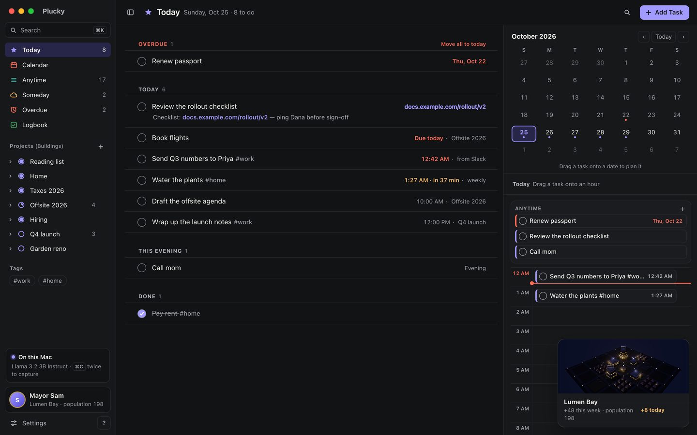

</div>

---

## Plucky in one minute

1. **Capture.** Copy any text and press <kbd>⌘C</kbd> again — or select it and press your capture shortcut. A card drops down from the menu bar with the task, its date and time already filled in. Press <kbd>Return</kbd>.
2. **Plan.** Your tasks sit in **Today**, **Calendar**, **Anytime** and **Someday**, in projects with sub-tasks and deadlines. Drag a task onto a day or an hour to plan it.
3. **Get reminded.** When a task's time comes, Plucky tells you — with **Done** and **Snooze** one click away.
4. **Watch your city grow.** Every task is a home in your own 3D city. Finish it, someone moves in, and the lights come on.

Everything runs on your Mac. There's no account, no cloud and no tracking.

## Your city: Lights On

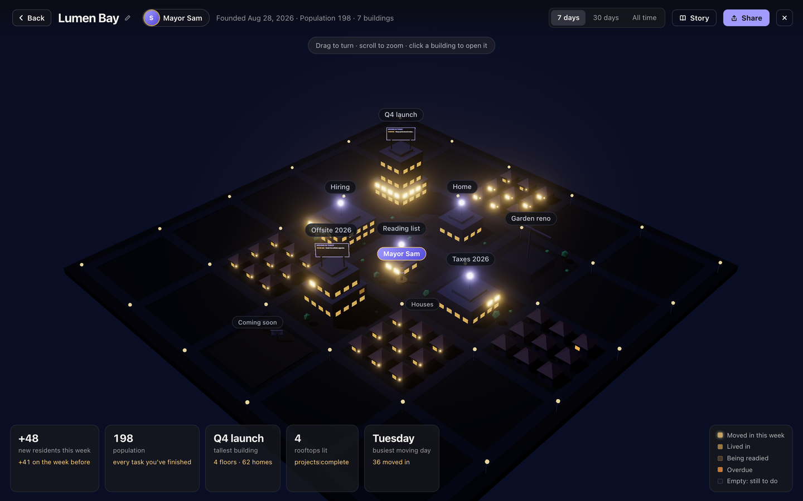

> **Every task is a home. Finish it, someone moves in, and the lights come on.**

You're the mayor of a new city. It starts quiet and dark, and your job is to fill it with people — and the only way anyone moves in is when you get something done.

| In your city | In Plucky | What you see |
| --- | --- | --- |
| **An apartment building** | A project | It goes up when you start the project. The older the project, the closer to downtown it stands. |
| **A floor** | A section of a project | You name it: "1st Floor: Travel", "2nd Floor: Program". Tasks on no floor live on the **ground floor**. |
| **A home** | A task | A new task is an empty home with a **dark** window. Finish it and someone moves in: the **lights come on**, and stay on for good. |
| **A faint glow** | Sub-tasks under way | Getting a home ready — paint, keys, boiler — is a checklist. Tick some sub-tasks and the window glows behind the curtains. |
| **Blinking amber** | An overdue task | Someone's waiting at the door. |
| **A house** | A task in no project | Little houses line the edge of town; their porch lights come on when they're done. |
| **"Coming soon" plots** | Someday ideas | Ideas you haven't committed to yet. |
| **"Moving in today" billboard** | Today's timed tasks | On the building's roof, in time order. |
| **A rooftop light** | A finished project | Every home in the building is lived in. |
| **A crane and trucks** | A project just starting | A crane over an empty lot; trucks circle buildings with nobody moved in yet. |
| **Luxury cars** | Your tallest tower | The project you've finished the most of. |
| **Population** | Every task you've finished | Your number as mayor: "Mayor Sam · Lumen Bay · population 198". |

**The shape of a building.** Each floor is as wide as its homes need — a floor with 20 homes is wider than one with 4. Floors are stacked with the most homes at the bottom, so every building narrows as it rises; when a floor outgrows the one below, Plucky restacks them (their names go with them).

**The city is alive.** Cars drive every street with soft headlights, a few trees and bushes line the pavements, trucks come and go around buildings under construction, and luxury cars circle your tallest tower. (Everything stays still if your Mac is set to reduce motion.)

**Explore it.** In full screen your city sits in the bottom-right corner and glows whenever someone moves in. Click it to open the city in 3D:

- **Drag** to turn it to any angle and tilt it, **scroll** to zoom, **double-click** to reset (arrow keys, <kbd>+</kbd> <kbd>−</kbd> and <kbd>0</kbd> work too).
- **Hover** a window to see its task — empty, being readied, overdue, or when someone moved in. Hover a building for how many homes are lived in and still empty.
- **Click a building** and Plucky glides to it and opens that project; click the houses for tasks in no project, or a plot for Someday.
- **Story** walks you through all of this, page by page.
- See the last **7 days**, **30 days** or **all time**: new residents, population, your tallest tower, finished projects and your busiest moving day.


**Share it.** **Share** makes a picture of your city with its name and, if you like, how many things you did this week. Copy it or save it to Downloads. The picture is made on your Mac and contains no task names, notes or times — and project names stay off unless you turn them on.

Prefer a clean screen? Make the city card small, or hide it in **Preferences**.

<br clear="right">

## Three ways to see your tasks

| | |
| --- | --- |
|  | **The side panel** docks at the edge of your screen: today's list, a week strip to drag tasks onto other days, and everything else one click away in the list menu. Press <kbd>⇧⌘H</kbd> to show or hide it, even over full-screen apps. |
|  | **The menu-bar dropdown** opens from the Plucky icon: today's agenda next to your calendar, frosted over whatever you're doing. Captures drop down here for review. |
|  | **Full screen** (<kbd>⌃⌘F</kbd>, or the expand button in the panel) turns Plucky into a full window with a sidebar, tasks that open in place, a month calendar on the right, a week calendar — and your city. It gets a Dock icon while it's open; the green button at the top left takes you back to the side panel. |

## Features

### Capture from anywhere

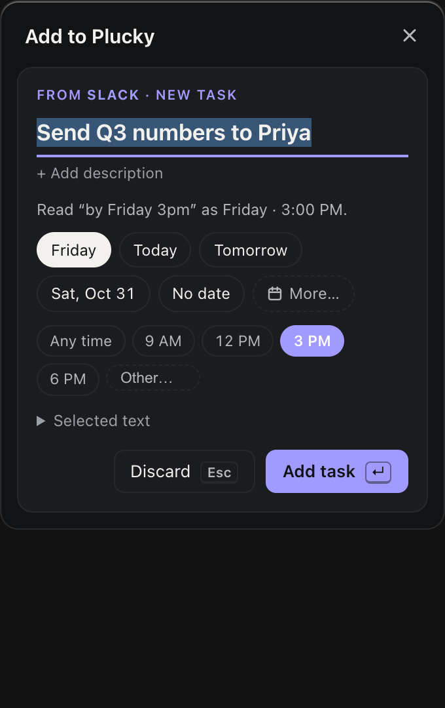

- **<kbd>⌘C</kbd> twice.** Copy as usual, then press <kbd>⌘C</kbd> again within a moment. Works in every app, no permissions needed.
- **Or a shortcut.** Select text and press <kbd>⇧⌘S</kbd> (change it in Preferences) — no copying at all. Or right-click → **Add to Plucky**.
- **Dates done right.** "by Friday 3pm", "every Monday", "tomorrow evening" become a real day, time and repeat — and "by Friday" becomes a **deadline**. When a phrase is ambiguous, Plucky asks instead of guessing.
- **Lists become sub-tasks.** Capture a bulleted list and it turns into a checklist.
- **Back to the source.** Each task remembers where it came from — the Slack thread, the email, the web page — and opens it in one click.

<br clear="right">

### Quick add

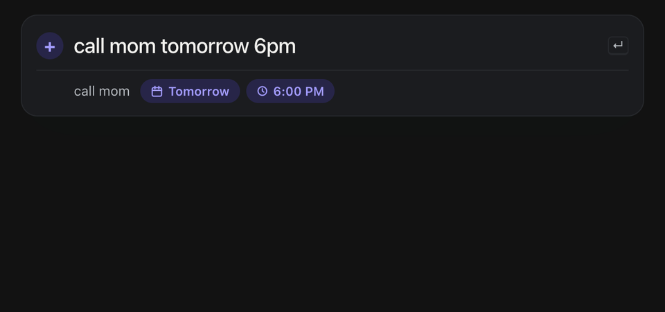

Press <kbd>⇧⌘Space</kbd> anywhere and type `pay rent friday 5pm every month #home`. Plucky shows how it reads the date as you type. (In the app's own add field, `@Name` also puts the task in a project.)

### Today, with its hours

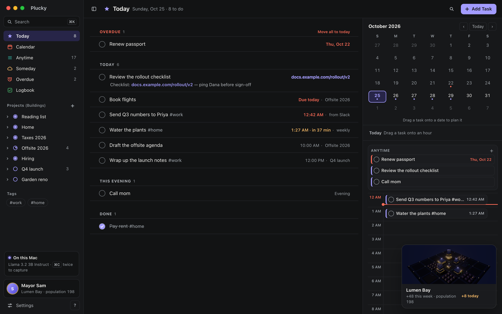

Today shows what's due and planned for **This evening**, with a **month calendar** and the day's hours beside it: drag a task onto an hour to time it, or onto a date to move it there. A dot under a date means something's planned; a red one means something's late. (In the side panel, press <kbd>V</kbd> to switch Today between a list and hours.)

### Overdue, in one place

Anything whose day, time or deadline has passed gathers in **Overdue** in the sidebar, with a count — instead of a banner on every screen. Move them to today in one click, reschedule by dragging onto the calendar, or tick them off.

### Your week

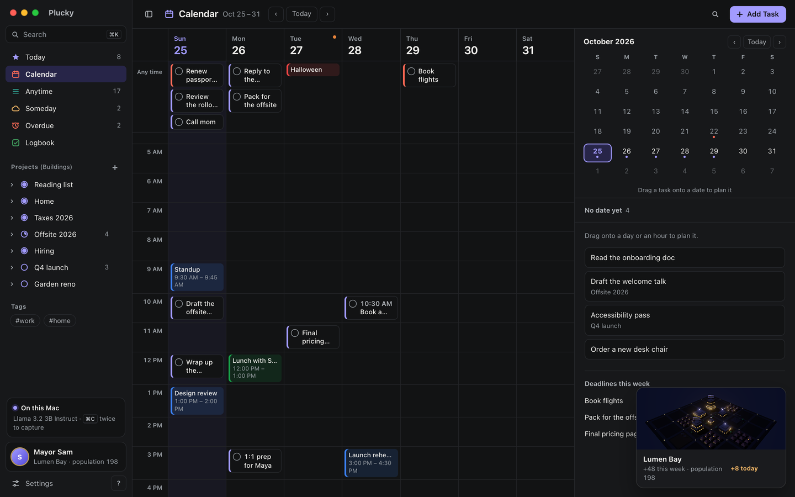

**Calendar** shows the next seven days, every hour of the day, filling the window — your tasks beside your calendar events. Drag tasks between days and hours, click an empty hour to add one there, and drag tasks with no date onto the week to plan them.

### Every detail of a task

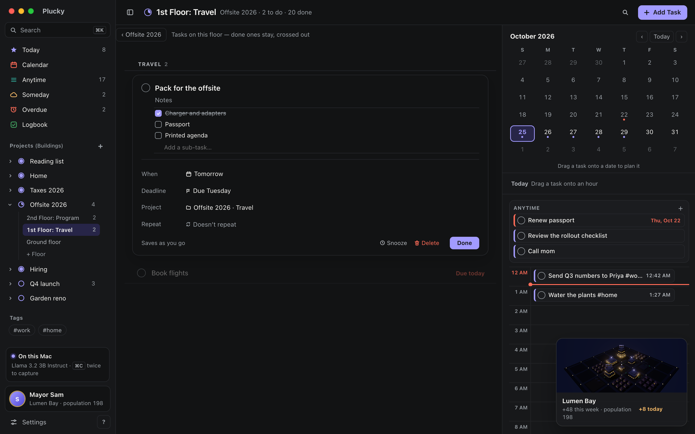

In full screen, every task shows its **notes** and **sub-tasks** right under it — tick sub-tasks without opening anything. Click a task and it opens **in place**: its title, notes, sub-tasks, **When** (a day, a time, this evening or someday), a separate **deadline**, its **project** and **floor**, and **repeat**. Snooze, skip one repeat, pause a series or delete — everything saves as you go, and **Done** closes it.

### Projects and floors

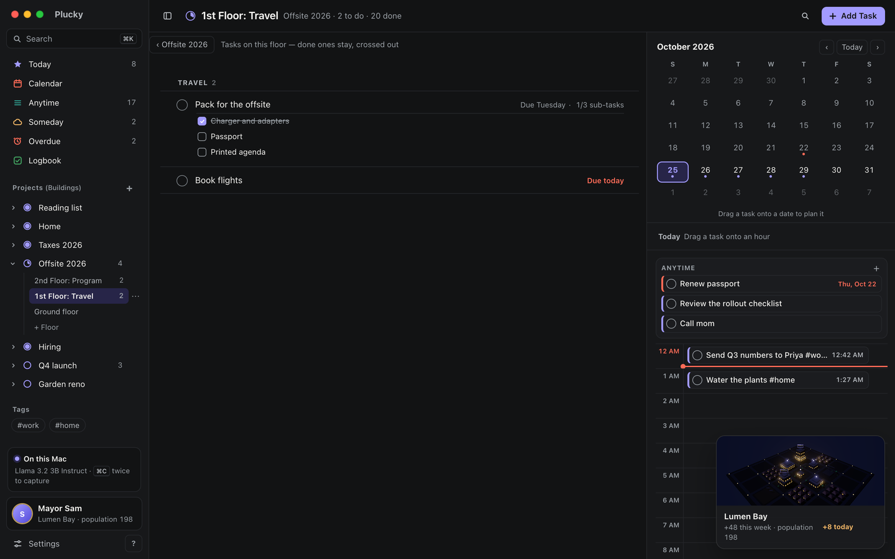

- **Start a project** with the **+** next to **Projects (Buildings)** in the sidebar — even before it has any tasks.
- **Open a project** in the sidebar to see its floors from the top down ("2nd Floor: Program", "1st Floor: Travel", "Ground floor"), with how many tasks each has to do. Click a floor for its own page: done tasks stay there, crossed out, and **Add Task** puts the new task straight on that floor.
- **Rename or delete** a project or a floor from its **⋯** menu. A project or floor can be deleted once it has no tasks left in it.
- **Add Task** at the top right picks the **project**, **floor**, **date** and **time** right in the form. The form closes once the task is added.

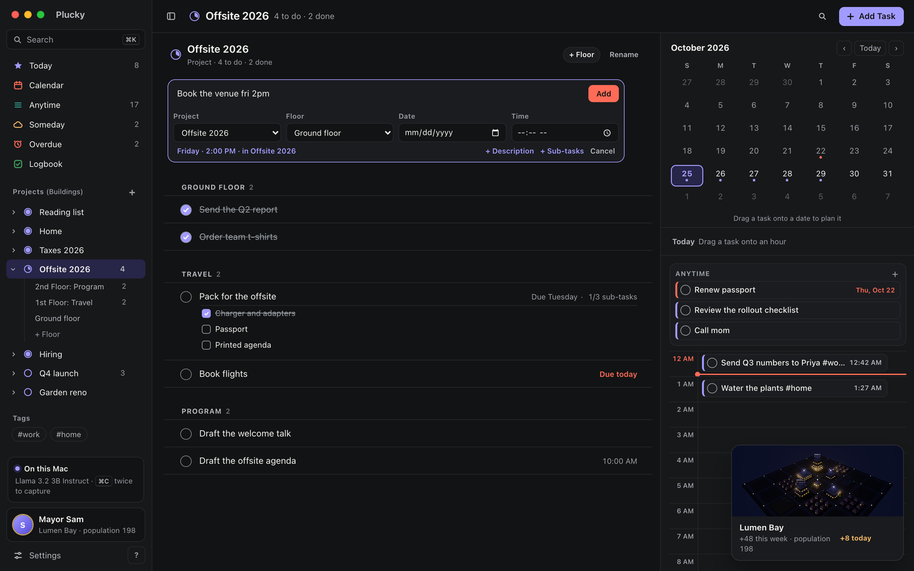

Finished tasks go to the **Logbook**; ideas you're not ready for wait in **Someday**.

### Reminders and check-ins

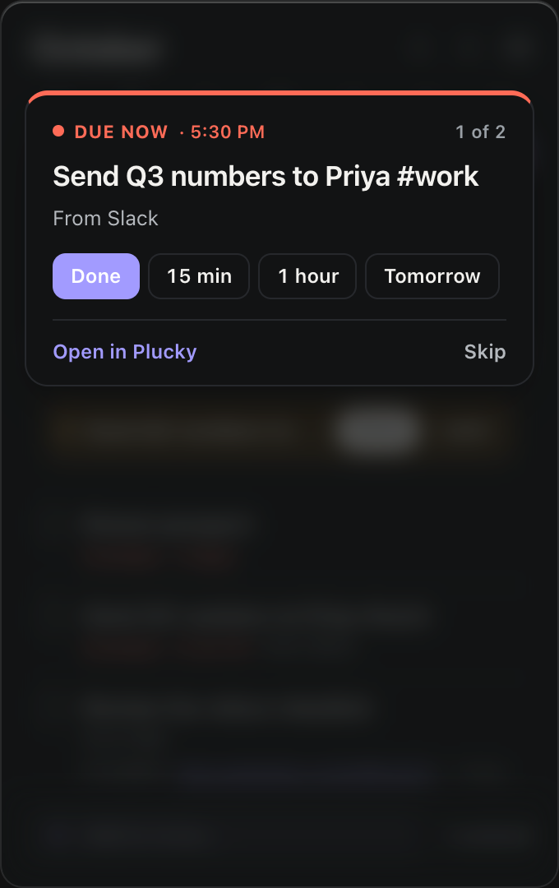

- Notifications with **Done**, **Snooze** and **Tomorrow** — or one morning summary instead.
- When a task's time comes, the menu-bar dropdown opens on just that task, everything else blurred. It never takes your keyboard.
- Once a day, it asks you to plan tasks that have no date, one tap each.
- Repeating tasks schedule the next one when you finish; skip one or pause the series any time.

<br clear="right">

### Connectors

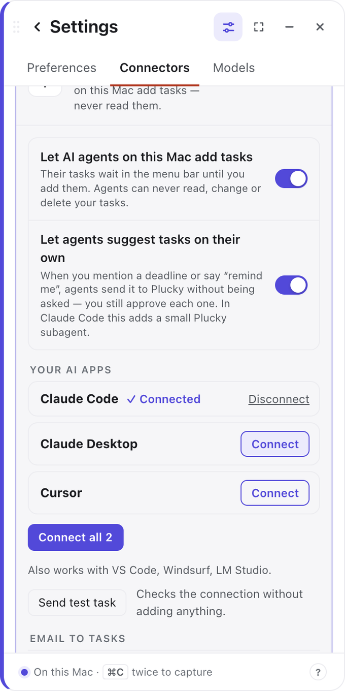

- **Calendar** shows your meetings beside your tasks (read-only; includes Google, Outlook and iCloud calendars added to the Mac).
- **Apple Reminders** syncs both ways — off by default.
- **AI agents** — Claude Code, Claude Desktop, Cursor, VS Code, Windsurf and LM Studio can *add* tasks ("add a Plucky task to send the deck Friday 3pm"). They can never read your list, and you approve every task.
- **Watch my screen** (optional) suggests tasks from what's in front of you — asks of you and things you promised — using the on-device model. Password managers, Keychain and terminals are never read.
- **Email to tasks** has Claude Code check your new Outlook email on a schedule and send the action items to Plucky for review.

<br clear="right">

### And more

- **Search and tags** — <kbd>/</kbd> or <kbd>⌘K</kbd> to search, `#tags` to filter, <kbd>⌘Z</kbd> undoes anything.
- **Select several** with <kbd>⌘</kbd>-click or <kbd>⇧</kbd>-click and complete, move or delete them together.
- **Dark by default**, light or following your Mac, with a purple accent.
- **Your data, your files** — one SQLite file on your Mac, daily backups, export to CSV or JSON.

## Install

1. **Download** [`Plucky-macOS.dmg`](https://github.com/pillieshwar/Plucky/releases/latest/download/Plucky-macOS.dmg).
2. **Open it** and drag **Plucky** into **Applications**.
3. **Launch Plucky.** If macOS says it can't verify the developer, open **System Settings → Privacy & Security**, click **Open Anyway** and confirm. You do this once.
4. **Follow the three-step tour.** Pick the on-device model (Plucky recommends the best one for your Mac and downloads it once), choose how to capture — <kbd>⌘C</kbd> twice, or a shortcut (which needs **Accessibility** access, how macOS lets an app read selected text) — and try a capture on a sample message.

There's nothing else to install. Plucky opens at login and updates itself — look for **Restart to update** when a new version is ready.

> **Coming from Pluck?** Pluck is now called Plucky. It updates itself as usual, renames itself to Plucky in Applications on first launch, and keeps your tasks, models, settings and login item.

**Verify your download (optional).** Every release is built by this repository's public release workflow and carries a signed build-provenance attestation. With the [GitHub CLI](https://cli.github.com):

```bash
gh attestation verify ~/Downloads/Plucky-macOS.dmg --repo pillieshwar/Plucky
```

Each release also lists SHA-256 checksums in `SHA256SUMS.txt`.

## Keyboard shortcuts

**Anywhere on your Mac** — change them in **Preferences → Keyboard shortcuts**:

| Shortcut | Action |
| --- | --- |
| <kbd>⌘C</kbd> <kbd>⌘C</kbd> | Capture what you just copied (copy, then press <kbd>⌘C</kbd> again) |
| <kbd>⇧⌘S</kbd> | Capture the selected text as a task (when you choose a shortcut instead) |
| <kbd>⇧⌘Space</kbd> | Quick add — type a task |
| <kbd>⇧⌘H</kbd> | Show or hide Plucky (handy over full-screen apps, where the menu bar is hidden) |

**In the task list** — press <kbd>?</kbd> to see them in the app:

| Key | Action | Key | Action |
| --- | --- | --- | --- |
| <kbd>↑</kbd> <kbd>↓</kbd> | Move between tasks | <kbd>T</kbd> / <kbd>M</kbd> / <kbd>W</kbd> | Move to today / tomorrow / next week |
| <kbd>Space</kbd> | Complete | <kbd>S</kbd> | Snooze |
| <kbd>E</kbd> | Edit title | <kbd>N</kbd> | Edit description |
| <kbd>D</kbd> | Change date and time | <kbd>O</kbd> | Open the source |
| <kbd>F</kbd> | Today ↔ Anytime | <kbd>⌫</kbd> | Delete |
| <kbd>/</kbd>, <kbd>⌘F</kbd> or <kbd>⌘K</kbd> | Search | <kbd>⌘Z</kbd> | Undo |
| <kbd>C</kbd> | Sub-tasks (checklist) | <kbd>P</kbd> | Move to a project |
| <kbd>V</kbd> | Today as a list or in hours | <kbd>A</kbd> | Add a task |
| <kbd>⌃⌘F</kbd> | Full screen ↔ side panel | <kbd>⌘\\</kbd> | Show or hide the sidebar (full screen) |

## Privacy

- **Your selections never leave your Mac.** Text is read through macOS Accessibility and sent only to the model runtime listening on `127.0.0.1`, with a random port and key for each session.
- **Tasks are stored locally** in `~/Library/Application Support/app.pluck.desktop/`, with seven days of backups in `backups/`.
- **Plucky uses the internet only for:** model downloads you start (from Hugging Face, verified against their SHA-256), checking GitHub for updates (you can turn this off in **Preferences → General**). There is no Plucky server.
- **AI agents can write, never read.** If you turn on **Connectors → AI agents**, apps on your Mac like Claude Desktop and Claude Code can send tasks to Plucky over MCP. They can't see, change or delete anything; each task waits in the menu bar until you add it. It works only on this Mac, through a private local connection — no network.
- **Watching your screen stays on your Mac.** If you turn on **Connectors → Watch my screen**, Plucky reads the text of the window in front (never password managers, Keychain, System Settings or terminals, and never what you type), runs the on-device model on new text, and keeps none of it.
- **No accounts, analytics or telemetry.** Notifications are scheduled by your Mac, not a server.
- **The one exception you control:** if you turn on Apple Reminders sync with a list stored in iCloud, those tasks sync through iCloud. Plucky warns you and asks first; pick an "On My Mac" list to stay fully local.

## How it works

```
select text ─▶ read selection ─▶ local model ─▶ resolve the date ─▶ you confirm ─▶ SQLite ─▶ reminder
               Accessibility,     JSON-schema     in code, against     Return to save
               clipboard fallback constrained     today's real date
```

1. **Capture** ([`src-tauri/src/capture/`](src-tauri/src/capture)) reads the selection with macOS Accessibility (`AXSelectedText`). If an app doesn't expose it, Plucky sends Copy and restores your clipboard afterwards — only if nothing else wrote to it in the meantime, and never when it holds images or files. **Add to Plucky** in the right-click menu receives the text directly from macOS and doesn't touch the clipboard at all.
2. **Extract** ([`src-tauri/src/engine.rs`](src-tauri/src/engine.rs), [`crates/pluck-core/src/llm.rs`](crates/pluck-core/src/llm.rs)) starts the bundled `llama-server` on demand and asks for exactly three fields — `task`, `date_text` and `date_confidence` — under a JSON Schema at temperature 0. Output is validated in Rust, with one repair retry. The runtime stops after five idle minutes to give the memory back.
3. **Resolve the date** ([`src/lib/dates.ts`](src/lib/dates.ts), [`src/lib/schedule.ts`](src/lib/schedule.ts)): the model only copies the phrase; deterministic code turns it into a day, time and repeat rule. Ambiguous phrases ("next Friday" on a Tuesday, `3/4`) offer both readings.
4. **Store and remind** ([`crates/pluck-core/src/store.rs`](crates/pluck-core/src/store.rs), [`src-tauri/src/notifications/`](src-tauri/src/notifications)) keeps tasks in SQLite and shows native notifications with actions when they're due.

Selected text is treated as untrusted input: it's wrapped and sanitized as data, instructions live only in the system prompt, and the strict schema means an injection can at worst produce an odd task title.

## Build from source

**Prerequisites:** Rust (stable), Node 20+, CMake and the [Tauri prerequisites](https://v2.tauri.app/start/prerequisites/) (`xcode-select --install` on macOS).

```bash
git clone https://github.com/pillieshwar/Plucky.git && cd Plucky
npm install
scripts/build-llama-server.sh   # build the bundled model runtime once (a few minutes)
npm run tauri dev               # run in development
npm run tauri build             # Plucky.app and a .dmg in target/release/bundle/
```

During `tauri dev`, macOS grants Accessibility permission to your terminal, not to Plucky. To use an existing Ollama instead of the bundled runtime, set `PLUCK_OLLAMA_URL=http://127.0.0.1:11434` (and optionally `PLUCK_MODEL`).

**Tests**

```bash
cargo test --workspace   # schema, prompt, retries, downloads, clipboard guard, store, sync, shortcuts
npm test                 # date, time and repeat parsing, quick add, due chips, search and tags
```

### Project layout

```
crates/pluck-core/   Platform-independent Rust: prompt and schema, model clients, verified downloads,
                     clipboard guard, SQLite store, recurrence, Reminders sync logic
src-tauri/           Tauri v2 shell: menu bar, shortcuts, windows, capture, notifications, updates
src/                 React + TypeScript UI: task panel, menu-bar popover, quick add; src/lib holds the logic
scripts/             llama-server build, icon rendering, UI preview screenshots
```

Built with [Tauri 2](https://tauri.app), Rust, React and TypeScript, [llama.cpp](https://github.com/ggml-org/llama.cpp) and SQLite.

## Troubleshooting

| Problem | Fix |
| --- | --- |
| "Apple could not verify Plucky…" | Expected for this build. **System Settings → Privacy & Security → Open Anyway**. |
| <kbd>⌘C</kbd> twice does nothing | Check that **Preferences → Press ⌘C twice to capture** is on and the Plucky icon is in the menu bar. Copies made inside Plucky itself are ignored. |
| <kbd>⇧⌘S</kbd> does nothing | Check that the Plucky icon is in the menu bar and Accessibility is allowed. If another app uses the same shortcut, pick a new one in **Preferences → Keyboard shortcuts**. |
| "No selected text found" | Select the text again. Password fields and some secure apps can't be read, by design. |
| **Add to Plucky** isn't in the right-click menu | Open Plucky from **Applications** once, then log out and back in. You can also enable it in **System Settings → Keyboard → Keyboard Shortcuts → Services → Text**. Some apps list it under **Services**. |
| No reminders appear | **Preferences → Notifications** shows whether they're allowed and can send a test notification. |
| Accessibility is asked for again after an update | In **Privacy & Security → Accessibility**, remove Plucky with **–**, then capture again and re-allow it. |
| The menu-bar icon is somewhere you don't want it | Hold **⌘** and drag it. macOS remembers the spot, including across updates. Plucky starts next to the battery, but never moves the icon again after that. |
| Something else | **Preferences → Show log file** opens Plucky's log. It stays on your Mac — attach it to an [issue](https://github.com/pillieshwar/Plucky/issues). |

## Uninstall

Quit Plucky from its menu-bar icon, move it from Applications to the Bin and remove it from **Privacy & Security → Accessibility**. To delete your tasks and models too:

```bash
rm -rf ~/Library/Application\ Support/app.pluck.desktop
```

## Contributing

Bug reports, ideas and pull requests are welcome.

1. Open an [issue](https://github.com/pillieshwar/Plucky/issues) describing the bug or idea — for bugs, attach the log from **Preferences → Show log file**.
2. Fork the repository and create a branch.
3. Run `cargo test --workspace` and `npm test` before opening a pull request. CI builds the app on macOS and Windows and runs the security checks. Commit `Cargo.lock` and `package-lock.json` changes along with the dependency change that caused them.

Maintainers: releases are cut from **Actions → Release → Run workflow** after bumping `version` in `package.json`, `src-tauri/tauri.conf.json` and `Cargo.toml`. The workflow builds a universal `.dmg`, signs the update archive and publishes `latest.json` for in-app updates.

## Security

Found a vulnerability? Please report it privately — see [SECURITY.md](SECURITY.md). Dependencies are locked (`Cargo.lock`, `package-lock.json`), updated weekly by Dependabot, and checked on every pull request by cargo-deny, npm audit, OSV-Scanner and zizmor.

## License

[MIT](LICENSE) © 2026 Eshwar Pilli
