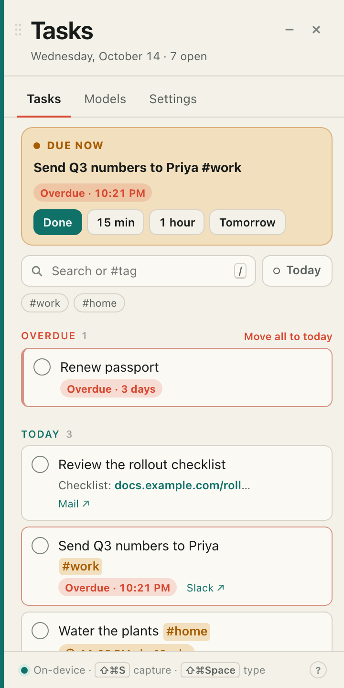
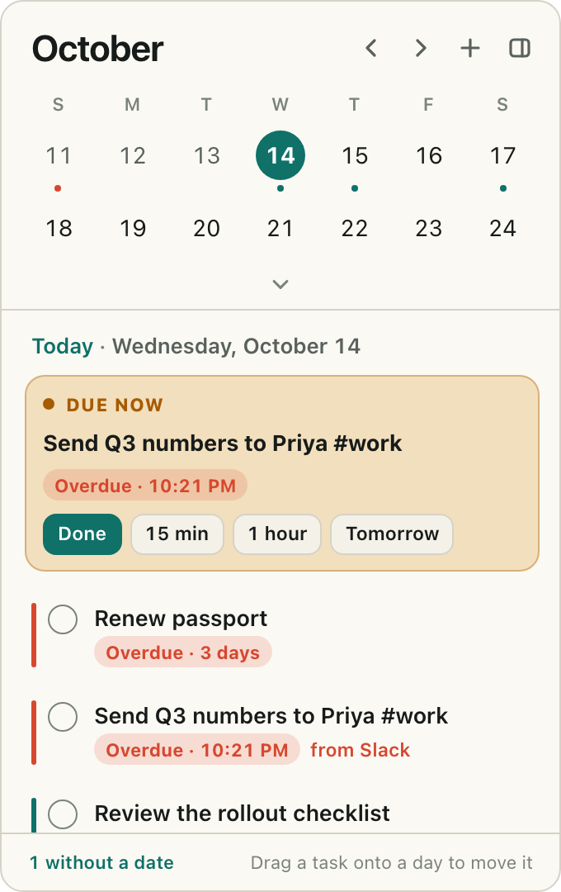

<div align="center">


# Plucky

**Turn any text you select into a dated task — privately, on your Mac.**

Select a message, an email or a web page, press <kbd>⇧⌘S</kbd>, and Plucky writes the to-do, finds the due date and reminds you on time.<br>
A small AI model runs entirely on your own computer, so nothing you select ever leaves it.

[](https://github.com/pillieshwar/pluck/releases/latest)
[](https://github.com/pillieshwar/pluck/actions/workflows/ci.yml)
[](#install)
[](LICENSE)

<a href="https://github.com/pillieshwar/pluck/releases/latest/download/Plucky-macOS.dmg"></a>

<sub>Free and open source · Apple silicon and Intel · one model download (about 2 GB) from inside the app</sub>

<br><br>

&nbsp;&nbsp;

</div>

---

## Why Plucky

Most to-dos start as text someone sent you — "can you send the deck by Friday 3pm?". Copying that into a task app, retyping the title and picking a date is just enough friction that it doesn't happen. Plucky removes the friction:

- **One shortcut from text to task.** Select, press <kbd>⇧⌘S</kbd>, press <kbd>Return</kbd>. Or right-click the selection and choose **Add to Plucky**.
- **Dates done right.** "by Friday 3pm", "every Monday", "tomorrow evening" become a real day, time and repeat. When a phrase is ambiguous, Plucky asks instead of guessing.
- **Private by design.** The model runs locally through a bundled [llama.cpp](https://github.com/ggml-org/llama.cpp) runtime. No account, no cloud, no telemetry.
- **Native and out of the way.** Lives in the menu bar, works over full-screen apps, opens at login and updates itself.

## Features

| | |
| --- | --- |
| **Capture from anywhere** | Select text in any app and press <kbd>⇧⌘S</kbd>, or right-click → **Add to Plucky**. The panel slides in with a suggested title, date and time. |
| **Quick add** | Press <kbd>⇧⌘Space</kbd> anywhere and type `pay rent friday 5pm #home` — Plucky shows how it reads the date as you type. |
| **Reminders that respect you** | Notifications with **Done**, **Snooze** and **Tomorrow** buttons, or one morning summary instead. A **Due now** card keeps fired reminders one click away. |
| **See what matters** | Due-time chips are red when overdue, amber when due soon, muted when done. **Today focus** (<kbd>F</kbd>) hides everything but today. |
| **Menu-bar calendar** | Click the icon for a month view and today's agenda. Drag a task onto another day to move it. |
| **Back to the source** | Each task remembers where it came from — the Slack thread, web page or file — and opens it in one click. |
| **Descriptions** | Add links and details to a task with **+ Add description**; links become clickable. |
| **Repeating tasks** | Completing "water plants every Monday" schedules the next one. |
| **Search and tags** | <kbd>/</kbd> to search, `#tags` to filter, undo everything with <kbd>⌘Z</kbd>. |
| **Apple Reminders sync** | Optional, two-way, off by default — with a clear warning if the list syncs through iCloud. |
| **Your data, your files** | Tasks live in one SQLite file on your Mac with daily backups, and export to CSV or JSON. |

## Install

1. **Download** [`Plucky-macOS.dmg`](https://github.com/pillieshwar/pluck/releases/latest/download/Plucky-macOS.dmg).
2. **Open it** and drag **Plucky** into **Applications**.
3. **Launch Plucky.** If macOS says it can't verify the developer, open **System Settings → Privacy & Security**, click **Open Anyway** and confirm. You do this once.
4. **Follow the short setup.** Plucky asks for **Accessibility** access (how macOS lets an app read selected text), downloads the recommended model (*Llama 3.2 3B Instruct*, about 2 GB, once), turns on reminders and lets you try a capture.

There's nothing else to install. Plucky opens at login and updates itself — look for **Restart to update** when a new version is ready.

> **Coming from Pluck?** Pluck is now called Plucky. It updates itself as usual, renames itself to Plucky in Applications on first launch, and keeps your tasks, models, settings and login item.

## Keyboard shortcuts

**Anywhere on your Mac** — change them in **Settings → Keyboard shortcuts**:

| Shortcut | Action |
| --- | --- |
| <kbd>⇧⌘S</kbd> | Capture the selected text as a task |
| <kbd>⇧⌘Space</kbd> | Quick add — type a task |
| <kbd>⇧⌘H</kbd> | Show or hide Plucky (handy over full-screen apps, where the menu bar is hidden) |

**In the task list** — press <kbd>?</kbd> to see them in the app:

| Key | Action | Key | Action |
| --- | --- | --- | --- |
| <kbd>↑</kbd> <kbd>↓</kbd> | Move between tasks | <kbd>T</kbd> / <kbd>M</kbd> / <kbd>W</kbd> | Move to today / tomorrow / next week |
| <kbd>Space</kbd> | Complete | <kbd>S</kbd> | Snooze |
| <kbd>E</kbd> | Edit title | <kbd>N</kbd> | Edit description |
| <kbd>D</kbd> | Change date and time | <kbd>O</kbd> | Open the source |
| <kbd>F</kbd> | Today focus | <kbd>⌫</kbd> | Delete |
| <kbd>/</kbd> or <kbd>⌘F</kbd> | Search | <kbd>⌘Z</kbd> | Undo |

## Privacy

- **Your selections never leave your Mac.** Text is read through macOS Accessibility and sent only to the model runtime listening on `127.0.0.1`, with a random port and key for each session.
- **Tasks are stored locally** in `~/Library/Application Support/app.pluck.desktop/`, with seven days of backups in `backups/`.
- **Plucky uses the internet for two things only:** model downloads you start (from Hugging Face, verified against their SHA-256) and checking GitHub for updates (you can turn this off in **Settings → General**).
- **No accounts, analytics or telemetry.** Notifications are scheduled by your Mac, not a server.
- **The one exception you control:** if you turn on Apple Reminders sync with a list stored in iCloud, those tasks sync through iCloud. Plucky warns you and asks first; pick an "On My Mac" list to stay fully local.

## How it works

```
select text ─▶ read selection ─▶ local model ─▶ resolve the date ─▶ you confirm ─▶ SQLite ─▶ reminder
               Accessibility,     JSON-schema     in code, against     Return to save
               clipboard fallback constrained     today's real date
```

1. **Capture** ([`src-tauri/src/capture/`](src-tauri/src/capture)) reads the selection with macOS Accessibility (`AXSelectedText`). If an app doesn't expose it, Plucky sends Copy and restores your clipboard afterwards — only if nothing else wrote to it in the meantime, and never when it holds images or files. **Add to Plucky** in the right-click menu receives the text directly from macOS and doesn't touch the clipboard at all.
2. **Extract** ([`src-tauri/src/engine.rs`](src-tauri/src/engine.rs), [`crates/pluck-core/src/llm.rs`](crates/pluck-core/src/llm.rs)) starts the bundled `llama-server` on demand and asks for exactly three fields — `task`, `date_text` and `date_confidence` — under a JSON Schema at temperature 0. Output is validated in Rust, with one repair retry. The runtime stops after five idle minutes to give the memory back.
3. **Resolve the date** ([`src/lib/dates.ts`](src/lib/dates.ts), [`src/lib/schedule.ts`](src/lib/schedule.ts)): the model only copies the phrase; deterministic code turns it into a day, time and repeat rule. Ambiguous phrases ("next Friday" on a Tuesday, `3/4`) offer both readings.
4. **Store and remind** ([`crates/pluck-core/src/store.rs`](crates/pluck-core/src/store.rs), [`src-tauri/src/notifications/`](src-tauri/src/notifications)) keeps tasks in SQLite and shows native notifications with actions when they're due.

Selected text is treated as untrusted input: it's wrapped and sanitized as data, instructions live only in the system prompt, and the strict schema means an injection can at worst produce an odd task title.

## Build from source

**Prerequisites:** Rust (stable), Node 20+, CMake and the [Tauri prerequisites](https://v2.tauri.app/start/prerequisites/) (`xcode-select --install` on macOS).

```bash
git clone https://github.com/pillieshwar/pluck.git && cd pluck
npm install
scripts/build-llama-server.sh   # build the bundled model runtime once (a few minutes)
npm run tauri dev               # run in development
npm run tauri build             # Plucky.app and a .dmg in target/release/bundle/
```

During `tauri dev`, macOS grants Accessibility permission to your terminal, not to Plucky. To use an existing Ollama instead of the bundled runtime, set `PLUCK_OLLAMA_URL=http://127.0.0.1:11434` (and optionally `PLUCK_MODEL`).

**Tests**

```bash
cargo test --workspace   # schema, prompt, retries, downloads, clipboard guard, store, sync, shortcuts
npm test                 # date, time and repeat parsing, quick add, due chips, search and tags
```

### Project layout

```
crates/pluck-core/   Platform-independent Rust: prompt and schema, model clients, verified downloads,
                     clipboard guard, SQLite store, recurrence, Reminders sync logic
src-tauri/           Tauri v2 shell: menu bar, shortcuts, windows, capture, notifications, updates
src/                 React + TypeScript UI: task panel, menu-bar popover, quick add; src/lib holds the logic
scripts/             llama-server build, icon rendering, UI preview screenshots
```

Built with [Tauri 2](https://tauri.app), Rust, React and TypeScript, [llama.cpp](https://github.com/ggml-org/llama.cpp) and SQLite.

## Troubleshooting

| Problem | Fix |
| --- | --- |
| "Apple could not verify Plucky…" | Expected for this build. **System Settings → Privacy & Security → Open Anyway**. |
| <kbd>⇧⌘S</kbd> does nothing | Check that the Plucky icon is in the menu bar and Accessibility is allowed. If another app uses the same shortcut, pick a new one in **Settings → Keyboard shortcuts**. |
| "No selected text found" | Select the text again. Password fields and some secure apps can't be read, by design. |
| **Add to Plucky** isn't in the right-click menu | Open Plucky from **Applications** once, then log out and back in. You can also enable it in **System Settings → Keyboard → Keyboard Shortcuts → Services → Text**. Some apps list it under **Services**. |
| No reminders appear | **Settings → Notifications** shows whether they're allowed and can send a test notification. |
| Accessibility is asked for again after an update | In **Privacy & Security → Accessibility**, remove Plucky with **–**, then capture again and re-allow it. |
| Something else | **Settings → Show log file** opens Plucky's log. It stays on your Mac — attach it to an [issue](https://github.com/pillieshwar/pluck/issues). |

## Uninstall

Quit Plucky from its menu-bar icon, move it from Applications to the Bin and remove it from **Privacy & Security → Accessibility**. To delete your tasks and models too:

```bash
rm -rf ~/Library/Application\ Support/app.pluck.desktop
```

## Contributing

Bug reports, ideas and pull requests are welcome.

1. Open an [issue](https://github.com/pillieshwar/pluck/issues) describing the bug or idea — for bugs, attach the log from **Settings → Show log file**.
2. Fork the repository and create a branch.
3. Run `cargo test --workspace` and `npm test` before opening a pull request. CI builds the app on macOS and Windows.

Maintainers: releases are cut from **Actions → Release → Run workflow** after bumping `version` in `package.json`, `src-tauri/tauri.conf.json` and `Cargo.toml`. The workflow builds a universal `.dmg`, signs the update archive and publishes `latest.json` for in-app updates.

## License

[MIT](LICENSE) © 2026 Eshwar Pilli
